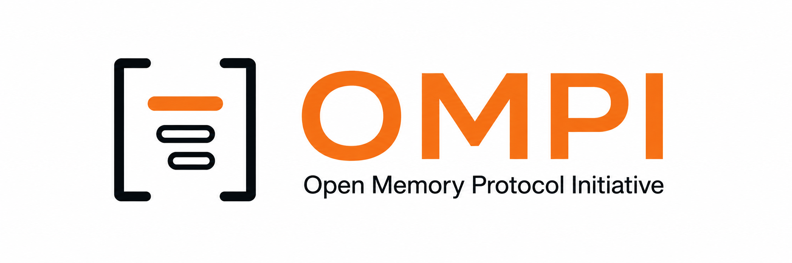

<p align="center">
  
</p>

<p align="center">
  <a href="https://openmemoryprotocol.org"><strong>Site</strong></a> ·
  <a href="working-group/exchange-and-runtime/2026-11-09-working-spec-v0.6.md"><strong>Working spec (v0.6)</strong></a> ·
  <a href="working-group/past-proposals/"><strong>Proposals</strong></a> ·
  <a href="prototypes/"><strong>Prototypes</strong></a> ·
  <a href="https://ompi.fly.dev"><strong>Live demo</strong></a> ·
  <a href="GOVERNANCE.md"><strong>Governance</strong></a> ·
  <a href="docs/contributing.md"><strong>Contribute</strong></a> ·
  <a href="https://discord.gg/B8Fhcech4"><strong>Discord</strong></a>
</p>

<p align="center">
  <sub><b>Hosted at</b></sub><br>
  <a href="https://ai-disclosures.org/"></a>
</p>

<p align="center">
  <sub><b>Co-convened with</b></sub><br>
  <a href="https://www.mozilla.org/"></a>
  &nbsp;&nbsp;&nbsp;&nbsp;&nbsp;&nbsp;&nbsp;&nbsp;
  <a href="https://www.ibm.com/"></a>
</p>

---

# Open Memory Protocol Initiative

The [Open Memory Protocol Initiative (OMPI)](https://openmemoryprotocol.org) is building an open protocol for agent memory, so that memory can move between agent systems and be shared between them. It is hosted at the [AI Disclosures Project](https://ai-disclosures.org/) ([Code for Science & Society](https://www.codeforsociety.org/)) and co-convened with IBM and Mozilla. This repository holds the working specification, the contributed proposals, prototypes and the governance documents.

## Current work

Pre-1.0, no reference implementation yet. First target: coding-agent harnesses.

- **Spec:** [editors' draft v0.6](working-group/exchange-and-runtime/2026-11-09-working-spec-v0.6.md), November 9, 2026. The memory object, its interchange and runtime forms, and exchange semantics; v0.5 reordered, with a proposed resolution for every open question. Companions: [agreed decisions](working-group/exchange-and-runtime/2026-11-09-working-spec-v0.6-decisions.md) and [open questions and record](working-group/exchange-and-runtime/2026-11-09-working-spec-v0.6-notes.md). Not adopted.
- **In review:** [PR #17](https://github.com/The-AI-Disclosures-Project/Open-Memory-Protocol/pull/17), a threat model for the memory object.
- **Background:** [September 28 notes](working-group/exchange-and-runtime/2026-09-28-common-ground.md), where the proposals agree and differ.
- **Next:** online hackathon, early December. [Vote on the date](https://forms.gle/ditdHjo1trjm9X7YA). <!-- remove after the hackathon -->
- [Open pull requests](https://github.com/The-AI-Disclosures-Project/Open-Memory-Protocol/pulls)

## Why an open protocol

Agent memory is persistent context that affects future model or agent behavior: user-provided facts, model- or agent-derived summaries, project instructions, prior decisions and actions, tool outputs, and references to underlying transcripts or artifacts. It is scoped to a user, project, organization, or shared group, and is distinct from a raw chat export. A memory system selects, transforms, organizes, retrieves, and expires information for future use.

The coding-agent harnesses surveyed (Claude Code, Codex, goose, OpenClaw, Letta Code, and others) all implement memory, but each uses a different convention: `AGENTS.md`, `MEMORY.md`, `USER.md`, `HUMAN.md`. Developers cannot move a stateful agent from one harness to another. Enterprises cannot switch memory providers without re-ingesting derived memory objects. Open-source memory projects duplicate one another because there is no shared object model, provenance format, or exchange format to converge on. Provenance is lost when memory is copied, and permissions that meant something in one system do not survive export. OMP aims to be the thinnest layer that addresses this while leaving storage backends, ownership models and internal architectures to implementers.

### What existing memory systems share

The [scoping note](working-group/past-proposals/scoping-note-2026-09.pdf) finds five practices a minimal protocol can standardize; the [prior-art survey](docs/prior-art/)'s convergence analysis reaches similar conclusions:

1. **Persistent memory across sessions.** Memory that survives the end of a conversation.
2. **Scope and ownership.** Every memory tied to a user, project, agent, team or organization.
3. **Lifecycle operations.** Create (remember), read (recall), update, delete (forget).
4. **Selective retrieval.** Agents request the memories relevant to the task, not the whole store.
5. **Controls and policy.** Privacy, access, retention, provenance, permission.

## Artifacts

Latest revision of each. Summaries, superseded revisions and how to add one: [`working-group/past-proposals/`](working-group/past-proposals/).

### Proposals

| Proposal | From | |
|---|---|---|
| Letta draft v0.2 | Charles Packer, Letta | [pdf](working-group/past-proposals/draft-v0.2-packer.pdf) |
| IBM proposal v0.1 | IBM | [pdf](working-group/past-proposals/draft-v0.1-ibm.pdf) |
| Federated Memory Protocol v0.2 | Sruly Rosenblat, AI Disclosures Project | [pdf](working-group/past-proposals/draft-v0.2-aidp.pdf) |
| Cognee proposal v0.1 | Cognee | [md](working-group/past-proposals/draft-v0.1-cognee.md) |
| Context Nest v0.1 | PromptOwl | [md](working-group/past-proposals/draft-v0.1-contextnest.md) |
| Knowledge object v0.2 | Sapience Labs | [md](working-group/past-proposals/draft-v0.2-sapience.md) |
| me.md | David Hamilton, Block / goose | [block/me.md](https://github.com/block/me.md) |

### Background

| Document | |
|---|---|
| Scoping note, Strauss and Rosenblat, August 2026 | [pdf](working-group/past-proposals/scoping-note-2026-09.pdf) |
| Prior-art survey, September 2026 | [docs/prior-art/](docs/prior-art/) |
| Agent Memory System Card, Mila and Mozilla | [md](working-group/past-proposals/ams-card.md) |
| The Memory Walled Garden, October 2025 | [docs/the-memory-walled-garden/](docs/the-memory-walled-garden/the-memory-walled-garden.md) |

### Code

| Prototype | Targets | |
|---|---|---|
| Cloudflare example, OMP gateway and memory stores on Workers with Cloudflare Artifacts storage | v0.5 minimal profile | [irvinebroque/omp-cloudflare](https://github.com/irvinebroque/omp-cloudflare) |
| omp-live, three memory systems and a coding agent kept in sync | OMP interchange records | [ompi.fly.dev](https://ompi.fly.dev) · [source](https://github.com/SrulyRosenblat/ompi-foo-camp/tree/main/omp-live) |
| Python loader / validator | Letta v0.2 draft | [prototypes/python-loader-validator/](prototypes/python-loader-validator/) |
| ACP memory server, session index over twelve harnesses | pre-OMP | [prototypes/acp_memory_server/](prototypes/acp_memory_server/) |

## Repository layout

```
working-group/exchange-and-runtime/   current editors' draft (v0.6) and working-group notes
working-group/past-proposals/         contributed proposals (latest revision of each; archive/ holds superseded ones), the scoping note, the AMS card
prototypes/                           experimental code
docs/                                 contributing guide, history, prior-art survey, the Memory Walled Garden essay
media/                                logos
GOVERNANCE.md · SECURITY.md · LICENSE · README.md
```

## How to contribute

- Issues and pull requests against the [v0.6 working spec](working-group/exchange-and-runtime/2026-11-09-working-spec-v0.6.md); proposals go in `working-group/past-proposals/`. Process, meetings and code conventions: [docs/contributing.md](docs/contributing.md).
- Discussion: [Discord](https://discord.gg/B8Fhcech4) (by application) or [ompi@aidisclosures.org](mailto:ompi@aidisclosures.org).

## Governance

Decisions go through a Technical Steering Group under the rules in [GOVERNANCE.md](GOVERNANCE.md): lazy consensus among maintainers, simple-majority TSG votes for unresolved questions, two-thirds for breaking changes. Contributions use a DCO sign-off. An external governance review in months 12–24 assesses the long-term home, with continued AI Disclosures Project / CS&S stewardship as the default. How the initiative got here: [docs/history.md](docs/history.md).

## License

- Specification documents: [CC BY 4.0](https://creativecommons.org/licenses/by/4.0/)
- Code in this repository: [Apache 2.0](LICENSE)
