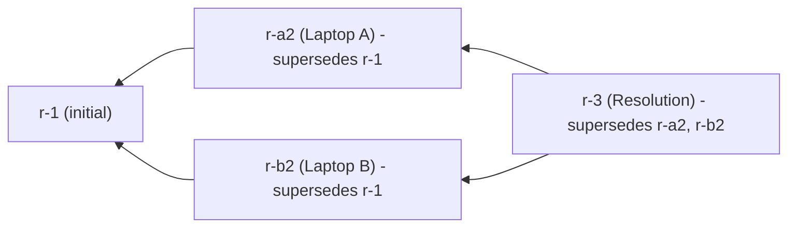
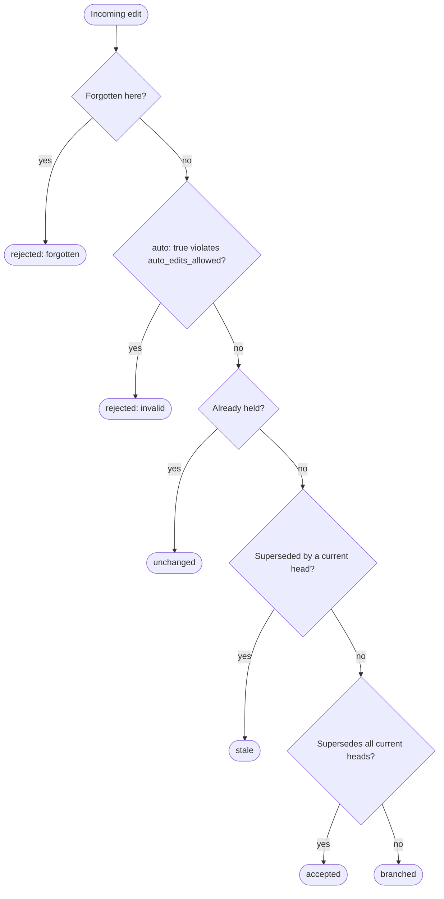

# Open Memory Protocol: Runtime Sync Specification (Personal Draft)

> **Personal draft — not yet discussed with the working group.**
> This is an individual discussion draft by Sruly Rosenblat (2026-11-23), not an adopted or working-group-reviewed OMP standard. It is intended solely as a concrete jumping-off point for the runtime specification; later drafts may go in a different direction.

Companions: [SPEC.md](../../SPEC.md) (targeting the v0.6 memory object, with notes on alignment with open draft PRs #40 and #41), [agreed decisions](2026-11-09-working-spec-v0.6-decisions.md), and [open questions and record](2026-11-09-working-spec-v0.6-notes.md).

This draft explores how OMP memory stores can exchange changes with each other in real time.

> **The whole design in five lines**
>
> 1. Every store keeps its own copy and accepts edits. Any reachable store can act as a relay for stores behind NAT, with no special authority.
> 2. Changes travel as OMP deltas (`selection: "changes"`) over three core endpoints: discovery (`info`), held pull (`GET /changes`), and idempotent push (`POST /changes`).
> 3. Order comes from an edit graph built on `rev` and `SPEC.md` `supersedes` links, never from version numbers, wall-clock time, or arrival order.
> 4. Concurrent edits remain separate heads until resolved by a new edit superseding all of them; `auto_edits_allowed` lets users protect memories and caps unattended automatic edits at one pass.
> 5. A `forget` tombstone erases content everywhere and outranks every past or future copy.

## 1. Scope

### Goals

- **Peer equality.** No store owns a memory. Any relay or peer can be removed and replaced without data loss.
- **NAT-friendly.** Works for local laptops and edge devices that cannot accept inbound connections.
- **Reuse the memory object.** Deltas carry standard [SPEC.md](../../SPEC.md) memories and tombstones.
- **Small enough to interoperate.** Two independent implementations should pass the [conformance tests](#8-conformance) from this document alone.

### Out of scope

Per [SPEC.md Part 2](../../SPEC.md#part-2-goals-and-scope), this specification takes no position on:

- **Agent-to-memory communication** (`remember`, `recall`, prompt hooks, MCP tool schemas). What fields a store exposes to an agent follows [SPEC.md §3.4](../../SPEC.md#34-representations-interchange-and-runtime).
- **Storage, indexing, embeddings, and retrieval algorithms.**
- **Federation without copying** (reading remote memories in place; see [SPEC.md §3.6.4](../../SPEC.md#364-federation)).
- **Automatic merge heuristics** and real-time collaborative text editing (CRDT/OT).
- **Access-control policy languages** and end-to-end body encryption.

### Terms

| Term | Meaning |
|---|---|
| **Store** | Any memory system with its own native format (Markdown folder, SQLite graph, search index, hosted service). |
| **Relay** | A role played by a network-reachable store that other stores sync through. It holds a full copy, applies the same receiving rules as any store, and has no special authority. |
| **Delta** | An OMP export with `manifest.selection: "changes"`, carrying changed edits and tombstones rather than a full export. |
| **Edit (revision)** | One immutable node in a memory's edit graph, identified by `(origin, identifier, rev)`. |
| **Head** | An edit that no other edit held by the store supersedes. |
| **Branch** | Two or more concurrent heads for the same memory. |

RFC 2119 keywords (**MUST**, **MUST NOT**, **SHOULD**, **SHOULD NOT**, **MAY**) carry their standard meanings.

## 2. Stores and Roles

A store acts as a **client** when it initiates a request and as a **server** when it answers one. A store **MAY** act as both. Two stores can sync directly whenever at least one is reachable as a server; a third store acting as a **relay** is only needed when neither can accept connections from the other (for example two laptops behind separate home routers).

- Every HTTP request is initiated by the client. A server **MUST NOT** require inbound connections to a client.
- A relay **MUST** store a full copy of every memory it relays and apply the same [receiving rules](#33-receiving-an-edit) as any peer. It holds no extra authority.
- A client **MUST** be able to switch to a different (or empty) relay, or sync via a copied export folder, without data loss.
- A server offering only `GET /omp/changes` is a read-only source; offering both `GET` and `POST` enables relaying between clients.


## 3. Identity and the Edit Graph

Sync does not use numeric versions or version comparators. Instead, each memory has a directed acyclic graph (DAG) of edits. Stores **MAY** still carry [SPEC.md §1.2](../../SPEC.md#part-1-the-memory-object)'s optional `version` field for display or audit profiles, and sync preserves it untouched without interpreting it.

### 3.1 Memory Identity

- A memory is globally identified by `(origin, identifier)` ([SPEC.md §3.5.1](../../SPEC.md#351-manifest-dependency)), compared as exact case-sensitive strings.
- Synced memories **MUST** use a generated `identifier` (UUID **RECOMMENDED**). Stores **MUST NOT** derive `identifier` from `path` or `title`, because independent stores will collide on names like `MEMORY.md`.
- In a delta, every memory and tombstone **MUST** carry its own `origin` field explicitly. `manifest.origin` names the **sending store** (for diagnostics and echo avoidance only) and grants no write or delete authority.
- `origin` records where an identifier was minted; it confers no ongoing ownership.

### 3.2 Edit Nodes (`rev`, `links`, `ancestors`)

- `rev` **MUST** be a non-empty opaque string unique within `(origin, identifier)` and **MUST NOT** be reused. A writer-computed hash over the edit and its direct parents (for example `sha256:...` or a short hash prefix) or a random unique ID is **RECOMMENDED**. Relays and receivers **MUST** preserve `rev` verbatim.
- **Direct parents via `SPEC.md` `links`:** An edit names every direct edit it replaces using a standard [SPEC.md §3.2](../../SPEC.md#32-links-and-lineage) `links` entry with `rel: "supersedes"`, `target` equal to the memory's own `identifier` (and matching `origin`, if present), and `rev` set to the parent's `rev` string. An initial edit has no self-targeting `supersedes` links; an ordinary edit has one; a branch resolution has two or more. Any `supersedes` link whose `target` is a *different* `identifier` is an ordinary link between memories, not edit lineage.
- `ancestors` is a list of earlier `rev` strings reachable through self-targeting `supersedes` links (nearest-first: direct parents first, then breadth-first across their ancestors, deduplicated, never including `rev` itself). A store minting an edit **SHOULD** include at least 32 entries (advertised in `limits.ancestors`) so peers can fast-forward across skipped edits without fetching intermediate bodies. A relaying store **MUST** preserve `ancestors` verbatim.
- Any change to a synced field (body, title, tags, links, provenance, or lifecycle metadata) creates a new edit node.

**Ordering rule:**

- Edit `A` **supersedes** edit `B` if `B`'s `rev` is reachable by walking self-targeting `supersedes` links from `A` in the store's graph, or appears in `A`'s `ancestors` list.
- If neither supersedes the other, `A` and `B` are **concurrent** and both remain heads.
- Wall-clock timestamps (`updated_at`, `created_at`) and arrival order **MUST NOT** decide which edit wins.
- If truncated `ancestors` lists and missing intermediate edits fail to connect two related edits, they are treated as concurrent; nothing is lost.



### 3.3 Receiving an Edit

A store applies these steps in order to every edit it receives (by pull, push, or folder import). The first matching rule decides:

1. **Forgotten.** A `forget` tombstone covers `(origin, identifier)` (either retiring the whole identifier or naming this specific `rev`). Store nothing. Outcome: `rejected` (`reason: "forgotten"`).
2. **Disallowed auto edit.** The edit has `auto: true` and either sets `auto_edits_allowed: true` or has a held direct parent (via self-targeting `supersedes` link) whose `auto_edits_allowed` is not `true` ([§4.2](#42-auto-revisions-and-loop-prevention)). Store nothing. Outcome: `rejected` (`reason: "invalid"`).
3. **Already held.** The store already holds this `(origin, identifier, rev)` (whether as a head or retained history). Outcome: `unchanged`.
4. **Stale.** The edit is not held, and its `rev` is superseded by a current head. Store nothing. Outcome: `stale`.
5. **Apply.** The edit becomes a head, and every current head superseded by it ceases to be a head.
   - If it is now the sole head: outcome `accepted`.
   - If other heads remain: keep all of them; outcome `branched`.



### 3.4 Branches

- A store **MUST** retain every concurrent head and emit all of them in `GET /omp/changes`. It **MUST NOT** silently drop a branch.
- How a store presents an unresolved branch to an agent or user is left to the implementation. Stores **SHOULD** surface the conflict (for example returning all heads or marking that another version exists) rather than silently hiding a branch.
- Resolving a branch writes a new edit with a self-targeting `supersedes` link (and `ancestors` entries) for every head being resolved.

## 4. Loop Prevention and Store Invariants

### 4.1 Store Invariants

The protocol does not prescribe how a store persists records internally. Every store that pushes changes **MUST** uphold three observable invariants:

1. **No phantom edits on import.** Importing or relaying an edit **MUST NOT** mint a new edit back onto the wire (for example, do not append `contribution: imported` to `provenance` as a synced edit, and do not emit format-only whitespace or key-order diffs).
2. **Preserve untouched fields.** When a store creates a new edit from a local change, all fields it did not modify—including unknown or unrepresented fields—**MUST** be carried over verbatim ([SPEC.md §1.2](../../SPEC.md#part-1-the-memory-object)).
3. **Keep all heads.** Stores whose native view displays one version at a time **MUST** still retain and sync any other concurrent heads until resolved.

*Implementation note:* Stores whose native format cannot hold full OMP metadata or multiple heads (such as a plain Markdown folder) typically keep a local metadata cache or sidecar alongside their native files to satisfy these invariants. Stores that cannot satisfy them **MUST NOT** push, though they can still conform as a **Reader**.

- **No mutation in transit.** A relaying store **MUST NOT** modify a received edit.
- **Keep derived data out of edits.** Embeddings, search indexes, and caches **MUST NOT** be written into synced memory edits; each store computes and stores its own locally so re-indexing never triggers sync traffic or bloats text stores.
- **Peer echo avoidance.** A store **MAY** remember `manifest.origin` from inbound pushes (and `/omp/info`'s `origin` on pulls) locally to skip pushing an edit straight back to the peer that sent it.

### 4.2 Auto Revisions and Loop Prevention

To let users protect memories from automated changes while allowing controlled reactive edits (such as auto-tagging, link extraction, or cleanup) without endless edit loops or auto-reverts, edits carry two optional booleans, `auto_edits_allowed` and `auto` (both default `false`):

- `auto_edits_allowed`: whether another store is permitted to apply an unattended automatic edit on top of this edit (`false` by default, protecting the memory).
- `auto`: `true` when this edit was generated automatically without direct user sign-off; `false` (or omitted) for human edits and user-signed-off edits.

| Edit kind | `auto` | `auto_edits_allowed` | Can follow `auto_edits_allowed: false`? | Allows an unattended auto edit next? |
|---|---|---|---|---|
| **Protected human / signed-off edit** | `false` | `false` | Yes | **No** |
| **Open human / signed-off edit** | `false` | `true` | Yes | Yes (one pass) |
| **Unattended auto edit** | `true` | `false` *(required)* | **No** (rejected) | **No** |

**Rules:**

- An unattended auto edit (`auto: true`) **MUST** only follow parent(s) with `auto_edits_allowed: true`, and **MUST** set `auto_edits_allowed: false` on the edit it creates (consuming the permission so no loop can form). Receivers **MUST** reject violations with `rejected` (`reason: "invalid"`).
- **Protecting memories & user sign-off:** A user protects any memory by keeping `auto_edits_allowed: false`. A system that wants to make an automated-style edit on a protected memory obtains user sign-off and emits `auto: false` with `auto_edits_allowed: false` (and **SHOULD** record the human in `provenance` with `contribution: "approved"`, `kind: "human"` per [SPEC.md §3.1.1](../../SPEC.md#311-contributor-list))—so another store still cannot automatically change it back.
- Automated processes **SHOULD** prefer emitting a separate `derived_from` memory ([SPEC.md §3.2](../../SPEC.md#32-links-and-lineage)) over mutating a source memory in place when producing summaries or extractions.

### 4.3 First Sync and Path Clashes

- A first sync between two populated stores assumes no shared history. Incoming memories arrive under their own `(origin, identifier)`.
- A store **MUST NOT** merge distinct memories based on matching titles, paths, or similarity.
- If an incoming memory's `path` collides with an existing local file, the store **MUST** place it at a non-conflicting local path without altering `record.path`, and **SHOULD** report `transformed` (with `changes` describing `local_path`) on first arrival only.
- Before applying a first sync, a client **SHOULD** preview changes using `POST /omp/changes?dry_run=true` and a local pull dry run.

## 5. Removing Memories

Sync distinguishes **local delete** (private to one store, never synced) from **forget** (global permanent erasure across all synced stores):

| Property | Local delete | Forget (global) |
|---|---|---|
| Scope | This store only; peers keep their copies. | Every store the tombstone reaches. |
| Wire object | **None** — local tombstone only, **MUST NOT** be exported or pushed. | Standard [SPEC.md §3.3.5](../../SPEC.md#33-versioning-and-lifecycle) tombstone in `tombstones`; no `rev` retires the identifier, `rev` present erases that edit only. |
| Modifiable / reversible | Yes — store can clear or restore it locally at any time. | Permanent — covered edit(s) or retired identifier can never return. |
| Required scope | *(local action)* | `omp:forget` |

*(To expire or archive a memory reversibly across all synced stores without erasing content, update its `valid_until` field per [SPEC.md §3.3.4](../../SPEC.md#334-invalidation-and-supersession) as an ordinary edit.)*

### 5.1 Local Delete

- A local delete removes a memory from this store's local view using a **local tombstone** that **MUST NOT** be included in `GET /omp/changes`, `POST /omp/changes`, or exports.
- The local tombstone stops a replay or snapshot pull of already-deleted edits from resurrecting the memory in this store, without affecting other stores.
- Because a local tombstone is purely local and modifiable, the store **MAY** allow a user to undo it locally (restoring from local history or pulling from a peer) and **MAY** choose whether a newer remote edit un-deletes the memory locally or stays hidden.

### 5.2 Forget (Global)

- Every tombstone sent on the wire in `tombstones` is a **forget** tombstone following [SPEC.md §3.3.5](../../SPEC.md#33-versioning-and-lifecycle) verbatim (`origin`, `identifier`, optional `rev`, `checksum`, `forgotten_at`, `reason`, `provenance`).
- **Whole-identifier forget** (no `rev`): retires `(origin, identifier)` permanently. Upon accepting it, a store **MUST** erase all content of every edit it holds—including `body`, `title`, `path`, `tags`, `links`, `provenance`, pending items, local caches, and undo-window history—retaining only the tombstone record.
- **Single-edit forget** (`rev` present): erases the content of that specific edit (keeping optional `checksum` for history verification per [SPEC.md §3.3.5](../../SPEC.md#33-versioning-and-lifecycle)). Other edits remain available, new edits may follow, and if the forgotten edit was a head, a snapshot exports the latest remaining head(s) alongside the tombstone.
- A store **MUST** retain every `forget` tombstone indefinitely and include it in snapshots, feeds, and exports so no stale copy can resurrect erased content.
- Receiving a `forget` for an unknown `(origin, identifier)` **MUST** store the tombstone (`accepted`) so future imports of covered edits are rejected.

### 5.3 Undo Window

A server **SHOULD** retain superseded edit bodies for at least 30 days (advertised as `undo_window_days`) unless forgotten, allowing recovery from accidental overwrites or misbehaving peers.

## 6. Routing, Trust, and Authorization

### 6.1 Outbound Routes

- Nothing pushes by default. A store sends a memory to a peer only when a user-configured route matches it (by `all`, `scope`, `tags`, or `path` prefix).
- Routes filter **outbound pushes**. Inbound visibility is controlled by the server's bearer token.
- `forget` tombstones **MUST** bypass routes and propagate to all connected peers so erasure spreads completely.

### 6.2 Trust Levels (`direct` vs `review`)

- Every peer configuration (for pulls) and every issued access token (for pushes) carries a trust level: `direct` or `review`. New peers and tokens **MUST** default to `review`.
- Under `review`, steps 1–4 of [§3.3](#33-receiving-an-edit) still evaluate immediately (`rejected`, `unchanged`, `stale`). Any item that would change state returns `pending` and is held invisible to agents and feed readers until a human approves it.
- Approving a pending item runs step 5 of [§3.3](#33-receiving-an-edit) at approval time. Forgets from a `review` peer **SHOULD** be surfaced promptly for approval.
- Imported provenance and evidence remain claims of the exporting origin ([SPEC.md §3.5.7](../../SPEC.md#357-trust-on-import)).

### 6.3 Authorization

- Outside loopback (`127.0.0.1`, `::1`), all HTTP traffic **MUST** use TLS.
- Every endpoint except `GET /omp/info` **MUST** require `Authorization: Bearer <token>` (loopback deployments **MAY** waive auth explicitly).
- Standard scopes:
  - `omp:read` — `GET /omp/changes`, `GET /omp/body`.
  - `omp:write` — push `memories` via `POST /omp/changes`.
  - `omp:forget` — push `tombstones` via `POST /omp/changes`.
- A `POST /omp/changes` request whose token has neither `omp:write` nor `omp:forget` **MUST** fail with `403 forbidden`. If a token has one scope and sends an item requiring the other, that item **MUST** receive a per-item `rejected` (`reason: "forbidden"`) receipt while authorized items proceed.
- Hosted services **SHOULD** issue tokens via OAuth 2.1 + PKCE and advertise RFC 9728 protected resource metadata on `401`. Self-hosted and local stores **MAY** use static bearer tokens. Credentials **MUST NOT** be synced as memory ([SPEC.md §3.5.6](../../SPEC.md#356-credentials)).

## 7. Wire Binding

### 7.1 HTTP Endpoints

All endpoints live under `<base-url>/omp/`. JSON requests and responses use `Content-Type: application/json` except `GET /omp/body`.

| Endpoint | Capability | Auth scope | Purpose |
|---|---|---|---|
| `GET /omp/info` | *(required)* | none | Store identity, `feed_id`, capabilities, and limits |
| `GET /omp/changes` | `sync/pull`, `sync/wait` | `omp:read` | Snapshot (no `since`) or incremental delta (`since`, optional `wait`) |
| `POST /omp/changes` | `sync/push` | `omp:write` / `omp:forget` | Push edits and tombstones; receive per-item receipts |
| `GET /omp/body` | `sync/body` | `omp:read` | Fetch raw body bytes when a delta sets `body_omitted: true` |

### 7.2 `GET /omp/info`

```json
{
  "protocol_version": "0.6",
  "origin": "store:5d0c7a52-91be-4c0e-8a11-0f6b2e7d3c90",
  "capabilities": ["sync/pull", "sync/wait", "sync/push", "sync/body"],
  "feed_id": "feed:41c0e6",
  "limits": {
    "max_wait": 25,
    "max_page": 100,
    "inline_body_bytes": 65536,
    "ancestors": 32
  },
  "undo_window_days": 30
}
```

### 7.3 `GET /omp/changes`

```
GET /omp/changes?since=<cursor>&limit=<n>&wait=<seconds>
```

- **Snapshot (no `since`):** Returns every current head (including all branches) and every `forget` tombstone visible to the token, paged with `has_more` and `cursor`. `wait` is ignored on snapshots; responses return immediately. The final page's `cursor` continues incrementally with no gap.
- **Incremental (`since` set):** Returns every edit that became a head (and every accepted tombstone) after the cursor, excluding forgotten edits. A server **MAY** elide intermediate edits superseded before the pull.
- **Held pull (`wait`):** When `since` is set and no changes are ready, a server advertising `sync/wait` holds the connection up to `min(wait, limits.max_wait)` seconds, returning immediately once a change lands or with empty lists and the same `cursor` on timeout.
- **Batch atomicity:** A page **MUST NOT** split items applied together in a single push; a page **MAY** slightly exceed `limit` to end on a batch boundary.
- **Opaque cursors & feed reset:** Cursors are server-issued opaque strings tied to `feed_id` (never wall-clock timestamps). Any cursor that is unknown, malformed, expired, or from a different `feed_id` **MUST** return `410 cursor_expired`.
- **Client recovery:** On `410 cursor_expired`—or if `/omp/info` reports a new `origin` or `feed_id`—a client **MUST** discard its pull cursor, pull a fresh snapshot (no `since`), and push its current routed state (ensuring a replacement empty relay recovers completely).

```json
{
  "manifest": {
    "protocol_version": "0.6",
    "origin": "store:5d0c7a52-91be-4c0e-8a11-0f6b2e7d3c90",
    "selection": "changes",
    "exported_at": "2026-11-23T16:20:04Z",
    "feed_id": "feed:41c0e6"
  },
  "memories": [
    {
      "origin": "store:6f1c2a9e-4b7d-4e2a-9c1f-3d8e5a7b0c42",
      "identifier": "9b2e7c14-3f6a-4d1e-8a5b-2c7f9e0d4b31",
      "rev": "r-a3f1c2e9",
      "links": [
        {
          "target": "9b2e7c14-3f6a-4d1e-8a5b-2c7f9e0d4b31",
          "rev": "r-77b0e41b",
          "rel": "supersedes"
        }
      ],
      "ancestors": ["r-77b0e41b", "r-1d9a050c"],
      "auto": false,
      "auto_edits_allowed": true,
      "media_type": "text/markdown",
      "created_at": "2026-09-15T09:30:00Z",
      "updated_at": "2026-11-23T16:19:58Z",
      "path": "team/status-update-day.md",
      "checksum": "sha256:9f2c1e0b6d4a8f3e...",
      "body": "Status updates are due Fridays."
    }
  ],
  "tombstones": [
    {
      "origin": "store:6f1c2a9e-4b7d-4e2a-9c1f-3d8e5a7b0c42",
      "identifier": "0c4d9e77-2a1b-4f60-b3c8-5e9d1a7f2b06",
      "forgotten_at": "2026-11-23T16:02:11Z",
      "reason": "user_request"
    },
    {
      "origin": "store:6f1c2a9e-4b7d-4e2a-9c1f-3d8e5a7b0c42",
      "identifier": "4f1a0d22-7c9e-4b11-a220-1b8d3e6f9c01",
      "rev": "r-51c9028d",
      "forgotten_at": "2026-11-23T16:10:00Z",
      "reason": "error"
    }
  ],
  "cursor": "c-000128",
  "has_more": false
}
```

### 7.4 `POST /omp/changes`

```
POST /omp/changes
Idempotency-Key: <client-generated-key>
```

Optional query parameter: `?dry_run=true` evaluates receipts without persisting anything or consuming the `Idempotency-Key`.

- **Envelope validation vs per-item rejection:** The server validates structure first. Invalid JSON, missing `manifest`, `manifest.selection != "changes"`, non-array `memories`/`tombstones`, or an item lacking `origin`/`identifier` (or lacking a non-empty string `rev` on a memory) **MUST** fail the whole request with `400 invalid` and apply nothing. Per-item faults (bad `checksum`/`body_checksum`, `auto_edits_allowed` violation, unsupported `body_encoding`, missing scope, forgotten memory, oversized body) return HTTP `200` with a per-item `rejected` receipt while valid items apply atomically.
- **Idempotency:** Retrying a non-dry-run push with the same `(token, Idempotency-Key)` within at least 24 hours **MUST** return the original response without re-applying changes.
- **Pull cursor independence:** `POST /omp/changes` does not return or advance a pull cursor; clients obtain pull cursors exclusively from `GET /omp/changes` so concurrent changes from other peers are never skipped.

Request body uses the same `manifest`, `memories`, and `tombstones` fields as `GET /omp/changes`. Response:

```json
{
  "receipts": [
    {
      "origin": "store:6f1c2a9e-4b7d-4e2a-9c1f-3d8e5a7b0c42",
      "identifier": "9b2e7c14-3f6a-4d1e-8a5b-2c7f9e0d4b31",
      "kind": "memory",
      "rev": "r-c80d174f",
      "outcome": "branched",
      "heads": ["r-a3f1c2e9", "r-c80d174f"]
    }
  ],
  "dry_run": false
}
```

| Outcome | Meaning |
|---|---|
| `accepted` | Stored; sole head (or accepted forget tombstone). |
| `unchanged` | Edit or forget tombstone already held. |
| `stale` | Edit is superseded by a current head; ignored. |
| `branched` | Stored alongside concurrent head(s); `heads` lists all current heads. |
| `transformed` | Accepted with local adaptation (for example `local_path` clash); `changes` describes the difference. |
| `pending` | Held for human review under `review` trust. |
| `rejected` | Not stored; `reason` is one of `forgotten`, `forbidden`, `invalid`, `too_large`, `unsupported`. |

### 7.5 Bodies and `GET /omp/body`

- Every memory edit **MUST** carry `body` as a string (use `""` for an empty body; `base64` with `body_encoding: "base64"` for binary content per [SPEC.md §1.1](../../SPEC.md#part-1-the-memory-object)) unless `body_omitted: true` is set.
- `checksum` follows [SPEC.md §1.2](../../SPEC.md#part-1-the-memory-object) (optional outside the audit profile; preserved untouched in transit). `body_checksum` (`sha256:<hex>` of the decoded body bytes) is a sync-binding field **REQUIRED** only when `body_omitted: true` and omitted otherwise. If `checksum` or `body_checksum` is present and fails verification, the item **MUST** be `rejected` (`reason: "invalid"`).
- A delta **MAY** omit `body` and set `body_omitted: true` when the body exceeds `limits.inline_body_bytes` or matches an edit in `ancestors`. A receiver that already holds matching `body_checksum` bytes reuses them; otherwise it fetches:

```
GET /omp/body?origin=<origin>&identifier=<identifier>&rev=<rev>
```

- `GET /omp/body` **MUST** return the raw decoded body bytes with `Content-Type` set to the memory's `media_type` and header `OMP-Body-Checksum: sha256:<hex>` (or `404 not_found` if absent). If an omitted body cannot be resolved (for example during a push), the item is `rejected` (`reason: "unsupported"`).
- A relaying store **MUST** preserve bodies byte-for-byte regardless of `media_type`, including types it cannot parse.

### 7.6 Errors and Client Backoff

Non-2xx responses carry `{ "error": "<code>", "message": "<text>" }`.

| Status | Code | When | Client behavior |
|---|---|---|---|
| `400` | `invalid` | Malformed JSON, manifest, or item identity | Do not retry unchanged request |
| `401` | `unauthenticated` | Missing or expired bearer token | Stop syncing peer; surface auth error |
| `403` | `forbidden` | Token lacks required scope | Stop syncing peer; surface auth error |
| `404` | `not_found` | Requested body not held | Handle per item |
| `405` | `invalid` | Unsupported HTTP method on `/omp/*` | Do not retry |
| `410` | `cursor_expired` | Unknown, expired, or wrong-`feed_id` cursor | Reset cursor; pull snapshot + push routed state |
| `413` | `too_large` | Request exceeds server size limit | Split batch or omit large bodies |
| `429` | `slow_down` | Rate limited | Wait `Retry-After` (or exponential backoff) |
| `501` | `unsupported` | Capability or endpoint not offered | Do not retry |

For network errors and `5xx` responses, clients **MUST** use exponential backoff (for example 1 s doubling to 30 s) and reset on success. Clients **MUST NOT** auto-retry `401` or `403`.

### 7.7 Local Directory Binding (Non-HTTP)

Local stores on the same machine (as in `omp-live`) **MAY** exchange deltas through a watched OMP export directory (`manifest.json`, `memories/`, `tombstones/`, `receipts/`) instead of HTTP. The identity, edit-graph ([§3](#3-identity-and-the-edit-graph)), loop-prevention ([§4](#4-loop-prevention-and-store-invariants)), and tombstone ([§5](#5-removing-memories)) rules apply identically without a server or bearer tokens.

## 8. Conformance

| Level | Requirements |
|---|---|
| **Reader** | Implements `GET /omp/info` + `GET /omp/changes`, stores a per-server cursor, applies [§3.3](#33-receiving-an-edit), honours `forget` tombstones, handles `410` resync. Never pushes. |
| **Peer** | Everything in **Reader**, plus store invariants ([§4.1](#41-store-invariants)), `auto` rules ([§4.2](#42-auto-revisions-and-loop-prevention)), `POST /omp/changes`, `Idempotency-Key`, and receipt handling. |
| **Server** | Everything in **Peer**, plus serving `/omp/info`, `/omp/changes` (GET and/or POST), auth scopes ([§6.3](#63-authorization)), trust gating ([§6.2](#62-trust-levels-direct-vs-review)), and undo window ([§5.3](#53-undo-window)). |

### Interoperability Test Matrix

Two independent implementations sharing only this specification **MUST** pass these checks against each other:

| # | Test | Pass condition |
|---|---|---|
| T1 | **Catch-up** | An offline peer pulls from its cursor and converges to identical heads. |
| T2 | **Idempotency & replay** | Replaying a pull or a push (with or without `Idempotency-Key`) creates no new edits. |
| T3 | **Stale arrival** | Pushing an unheld older edit superseded by a current head returns `stale`. |
| T4 | **Skipped edits** | A peer several edits behind accepts the newest edit as `accepted` (no branch). |
| T5 | **Concurrent branch & resolve** | Concurrent edits on two peers leave both holding 2 heads; one resolution edit with `supersedes` links to both heads converges both. |
| T6 | **No echo loop & auto protection** | Round-tripping edits across different native formats mints zero phantom edits; an `auto: true` edit on a parent with `auto_edits_allowed: false` (or setting `auto_edits_allowed: true`) returns `rejected` (`invalid`); an `auto: true` edit on `auto_edits_allowed: true` succeeds with `auto_edits_allowed: false`, blocking loops and auto-reverts unless a human signs off (`auto: false`). |
| T7 | **Unknown fields** | Extension and unrepresented fields survive a round trip and local edit intact. |
| T8 | **First sync & path clash** | Two populated stores merge inventories without collapsing distinct memories; a local path clash preserves `record.path` and reports `transformed`. |
| T9 | **Local delete isolation** | A local delete removes the memory on one store without exporting a tombstone or removing it on peers, stays deleted across replay/resync, and can be restored locally. |
| T10 | **Forget & anti-resurrection** | `forget` erases content everywhere; re-pushing an archived copy returns `rejected` (`forgotten`). |
| T11 | **Relay replacement & feed reset** | Replacing a relay with an empty store (or triggering `410 cursor_expired`) resyncs cleanly with zero data loss. |
| T12 | **Trust & auth** | Missing token returns `401`; read-only push returns `403`; a `review` push returns `pending` and stays hidden from feeds until approved. |

## 9. Alignment with `SPEC.md` and Deferred Extensions

### Alignment with `SPEC.md` (v0.6.1, PR #40 & PR #41)

| `SPEC.md` area | What this draft relies on or proposes |
|---|---|
| §1.2 `identifier` & `checksum` | Generated exact case-sensitive ids required for synced memories; uses §1.2 `checksum` (no extra `body_checksum` except on `body_omitted: true`, matching PR #41). |
| §3.2 `links` & §3.3.2 `version` | Sync ignores `version` and `version_comparator`, building the edit graph from `rev` + self-targeting `rel: "supersedes"` entries in `SPEC.md` `links` + `ancestors`. Optional `version` values are preserved untouched. |
| §3.3.5 Tombstones (PR #40) | Wire `tombstones` are `SPEC.md` §3.3.5 `forget` tombstones verbatim (whole-identifier when `rev` is absent, single-edit when `rev` is present). Local deletes are never exported. |
| §3.5.1 Manifest | Adds `selection: "changes"`, `feed_id`, and explicit per-record `origin`. |
| §3.5.4 Receipts | Uses sync outcomes `accepted`, `unchanged`, `stale`, `branched`, `transformed`, `pending`, `rejected` (also compatible with issue #35 if receipts move out of the memory object spec into this runtime spec). |
| Part 2 & §3.6 (PR #41) | Directly implements Part 2's store-to-store real-time exchange while leaving agent-to-memory communication, storage layout, and recall signatures out of scope. |

### Sync-layer fields (beyond `SPEC.md` §1.2)

Fields introduced by this specification on synced memories and tombstones (all other fields come directly from [SPEC.md §1.2](../../SPEC.md#part-1-the-memory-object) and [§3.3.5](../../SPEC.md#33-versioning-and-lifecycle)):

| Field | On | Purpose |
|---|---|---|
| `origin` | memory, tombstone | Minting store identifier (per-record so relays carry mixed origins; `SPEC.md` currently puts it on the manifest). |
| `rev` | memory, optional tombstone, `supersedes` link | Unique opaque edit ID in the memory's edit graph. |
| `ancestors` | memory | Recent ancestor `rev` IDs (nearest-first) so lineage survives skipped or purged middle edits. |
| `auto` | memory (optional, default `false`) | Marks unattended automatic edits for loop enforcement. |
| `auto_edits_allowed` | memory (optional, default `false`) | Lets users protect memories and caps unattended automatic edits at one pass. |
| `body_omitted`, `body_checksum` | memory (optional) | Allows large or unchanged bodies to be fetched separately via `GET /omp/body`. |

### Intentionally Deferred Extensions

Kept out of the core specification so initial implementations stay small:

- **Revision-pinned annotations** for sharing computed metadata (such as embeddings or extracted entities) across stores without mutating memory edits.
- **Rule-based auto-merging** (deterministic three-way text merge on non-overlapping line edits).
- **Forget acknowledgements (`acks`)** confirming which peers have applied an erasure (raises topology-disclosure tradeoffs).
- **Per-token withdrawals** when a token loses access to a previously synced scope (use [federation](../../SPEC.md#364-federation) where copies cannot be handed out).
- **Server-to-server webhook notifications** (carrying only a hint to pull).
- **Encrypted-body envelope profile** for zero-knowledge relays (note [§7.5](#75-bodies-and-get-ompbody) already guarantees opaque byte-for-byte relay passthrough).
